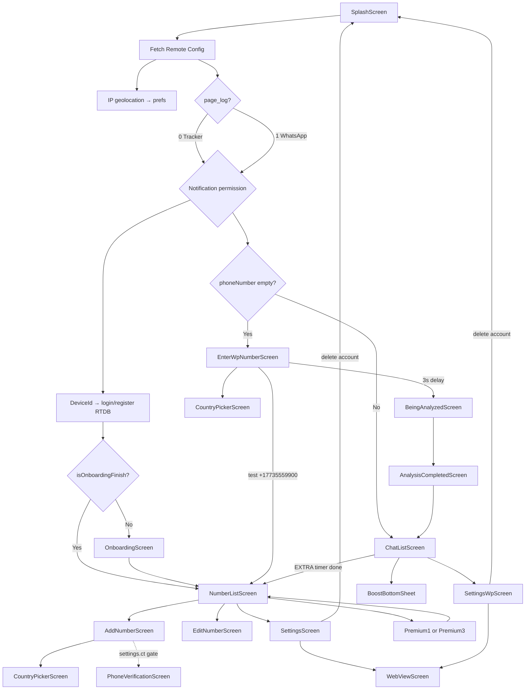

# LifeSeen Flutter — Implementation Guide

**Project:** `lifeseen_flutter`  
**Package:** `com.app.lifeseen`  
**Version:** 1.1.3+14  
**Android source of truth:** `LogSense-Reconstructed` (`com.app.lifeseen`)  
**Firebase project:** `whatsapp-mode`

This document is the single reference for building, extending, or porting LifeSeen functionality into Flutter. Android behavior always takes priority over assumptions.

---

## Table of contents

1. [Architecture overview](#1-architecture-overview)
2. [Project structure](#2-project-structure)
3. [Navigation system](#3-navigation-system)
4. [Complete navigation flow](#4-complete-navigation-flow)
5. [State management](#5-state-management)
6. [Data layer](#6-data-layer)
7. [Remote Config](#7-remote-config)
8. [Firebase Realtime Database schema](#8-firebase-realtime-database-schema)
9. [Device auth (Tracker mode)](#9-device-auth-tracker-mode)
10. [SharedPreferences mapping](#10-sharedpreferences-mapping)
11. [Feature catalog — Android to Flutter](#11-feature-catalog--android-to-flutter)
12. [Premium / Boost / Timer — local unlock](#12-premium--boost--timer--local-unlock)
13. [Notifications](#13-notifications)
14. [Phone verification](#14-phone-verification)
15. [WebView & legal URLs](#15-webview--legal-urls)
16. [Offline-first](#16-offline-first)
17. [Android vs Flutter differences](#17-android-vs-flutter-differences)
18. [Implementation status](#18-implementation-status)
19. [Setup & run](#19-setup--run)
20. [Completing the app checklist](#20-completing-the-app-checklist)
21. [Adding real IAP later](#21-adding-real-iap-later)

---

## 1. Architecture overview

### Mandatory stack (locked requirements)

| Layer                  | Technology                                         | Forbidden alternatives              |
| ---------------------- | -------------------------------------------------- | ----------------------------------- |
| Navigation             | `Navigator` + `NavigationUtils` + `RouteGenerator` | go_router, auto_route, beamer, GetX |
| State                  | `Provider` + `ChangeNotifier`                      | Riverpod, Bloc, Cubit, MobX, Redux  |
| Backend                | Firebase Realtime Database (primary)               | Direct Firebase calls from UI       |
| Offline                | SharedPreferences + Hive write queue               | —                                   |
| Monetization (current) | Local unlock only                                  | Real billing until Phase 2          |

### Data flow (never bypass)

```
Firebase Realtime Database
        ↓
FirebaseDatabaseService   (lib/services/firebase/)
        ↓
AppRepository             (lib/repositories/)
        ↓
Provider (ChangeNotifier) (lib/providers/)
        ↓
Screen / Widget           (lib/features/)
```

UI must **never** read or write Firebase directly.

### Boot sequence (`main.dart`)

```
WidgetsFlutterBinding.ensureInitialized()
  → Firebase.initializeApp(firebase_options.dart)
  → Hive.initFlutter()
  → OfflineWriteQueue.init()
  → PrefRepository.create()
  → AppRepository(db, prefs)
  → appRepository.flushOfflineQueue()
  → runApp(LifeSeenApp)
```

---

## 2. Project structure

```
lifeseen_flutter/
├── lib/
│   ├── main.dart                          # App entry + DI bootstrap
│   ├── app.dart                           # MaterialApp + MultiProvider
│   ├── firebase_options.dart              # whatsapp-mode Firebase config
│   │
│   ├── core/
│   │   ├── constants/
│   │   │   ├── route_names.dart           # All route strings
│   │   │   ├── firebase_paths.dart        # RTDB path helpers
│   │   │   ├── pref_keys.dart             # SharedPreferences keys
│   │   │   └── legal_urls.dart            # EULA, privacy, terms, support
│   │   ├── navigation/
│   │   │   ├── navigation_utils.dart      # Global navigator key + helpers
│   │   │   └── route_generator.dart       # onGenerateRoute switch
│   │   ├── theme/
│   │   │   └── app_theme.dart             # AppColors + dark ThemeData
│   │   └── utils/
│   │       ├── device_id.dart             # SHA-256 device UUID (Android parity)
│   │       ├── ip_location_manager.dart   # Splash geolocation
│   │       └── ui_state.dart              # UiLoading / UiSuccess / UiFailure
│   │
│   ├── models/
│   │   ├── remote_config_model.dart       # RemoteConfigModel + SettingsModel
│   │   └── tracked_number.dart            # Tracker contact model
│   │
│   ├── data/
│   │   └── chat_data.dart                 # Static WP chat list + decrypt texts
│   │
│   ├── services/
│   │   ├── firebase/
│   │   │   ├── firebase_database_service.dart
│   │   │   ├── firebase_remote_config_service.dart
│   │   │   └── firebase_auth_service.dart
│   │   ├── timer/
│   │   │   ├── timer_manager.dart         # INITIAL → BOOST → EXTRA
│   │   │   └── timer_models.dart
│   │   ├── notification/
│   │   │   └── notification_scheduler.dart
│   │   └── offline/
│   │       └── offline_write_queue.dart
│   │
│   ├── repositories/
│   │   ├── pref_repository.dart           # All local prefs
│   │   └── app_repository.dart            # RTDB CRUD (Firestore parity)
│   │
│   ├── providers/
│   │   └── app_providers.dart             # RemoteConfig, Auth, Prefs providers
│   │
│   └── features/
│       ├── splash/presentation/splash_screen.dart
│       ├── onboarding/presentation/onboarding_screen.dart
│       ├── tracker/
│       │   ├── number_list/presentation/number_list_screen.dart
│       │   ├── add_number/presentation/add_number_screen.dart
│       │   ├── edit_number/presentation/edit_number_screen.dart
│       │   ├── country_picker/presentation/country_picker_screen.dart
│       │   ├── phone_verification/presentation/phone_verification_screen.dart
│       │   └── settings/presentation/settings_screen.dart
│       ├── premium/presentation/premium1_screen.dart
│       ├── premium/presentation/premium3_screen.dart
│       ├── webview/presentation/web_view_screen.dart
│       └── whatsapp/
│           ├── enter_number/presentation/enter_wp_number_screen.dart
│           ├── analysis/presentation/being_analyzed_screen.dart
│           ├── analysis/presentation/analysis_completed_screen.dart
│           ├── chat_list/presentation/chat_list_screen.dart
│           ├── settings/presentation/settings_wp_screen.dart
│           └── widgets/
│               ├── boost_bottom_sheet.dart
│               └── messages_ready_dialog.dart
│
├── assets/
│   ├── lottie/
│   ├── images/
│   ├── json/
│   └── videos/onboarding/
│
└── docs/
    ├── FLUTTER_IMPLEMENTATION_GUIDE.md    # This file
    └── COMPONENT_CLASSIFICATION_REPORT.md
```

---

## 3. Navigation system

### NavigationUtils (`lib/core/navigation/navigation_utils.dart`)

Mirrors Android Activity-style navigation.

| Method                                                 | Android equivalent           | Usage                     |
| ------------------------------------------------------ | ---------------------------- | ------------------------- |
| `NavigationUtils.push(route, {arguments})`             | `startActivity`              | Forward navigation        |
| `NavigationUtils.pushReplacement(route)`               | `startActivity` + `finish()` | Replace current screen    |
| `NavigationUtils.pushAndRemoveUntil(route, predicate)` | `CLEAR_TASK`                 | Reset stack               |
| `NavigationUtils.pop([result])`                        | `finish()` + `setResult`     | Back with optional result |
| `NavigationUtils.showAppDialog(widget)`                | `Dialog.show()`              | Modal dialog              |
| `NavigationUtils.showAppBottomSheet(widget)`           | BottomSheetDialog            | Boost sheet               |
| `NavigationUtils.clearStackToSplash()`                 | Delete account flow          | Clears to `/`             |

Global key: `NavigationUtils.navigatorKey` — wired in `MaterialApp`.

### Route names (`lib/core/constants/route_names.dart`)

| Route constant                 | Path                     | Android Activity               |
| ------------------------------ | ------------------------ | ------------------------------ |
| `RouteNames.splash`            | `/`                      | SplashActivity                 |
| `RouteNames.onboarding`        | `/onboarding`            | OnBoardingActivity             |
| `RouteNames.numberList`        | `/tracker/number-list`   | NumberListActivity             |
| `RouteNames.addNumber`         | `/tracker/add-number`    | AddNumberActivity              |
| `RouteNames.editNumber`        | `/tracker/edit-number`   | EditNumberActivity             |
| `RouteNames.countryPicker`     | `/country-picker`        | CountryCodeActivity            |
| `RouteNames.phoneVerification` | `/phone-verification`    | PhoneVerificationActivity      |
| `RouteNames.settings`          | `/tracker/settings`      | SettingsActivity               |
| `RouteNames.premium1`          | `/premium/1`             | Premium1Activity               |
| `RouteNames.premium3`          | `/premium/3`             | Premium3Activity               |
| `RouteNames.webView`           | `/web-view`              | activity_web_view.xml (orphan) |
| `RouteNames.enterWpNumber`     | `/wp/enter-number`       | EnterWpNumberBlackActivity     |
| `RouteNames.beingAnalyzed`     | `/wp/being-analyzed`     | BeingAnalyzedBlackActivity     |
| `RouteNames.analysisCompleted` | `/wp/analysis-completed` | AnalysisCompletedActivity      |
| `RouteNames.chatList`          | `/wp/chat-list`          | ChatListActivity               |
| `RouteNames.settingsWp`        | `/wp/settings`           | SettingsWpActivity             |

### Route arguments

| Screen                    | Arguments map                                      |
| ------------------------- | -------------------------------------------------- |
| `EditNumberScreen`        | `TrackedNumber` object                             |
| `PhoneVerificationScreen` | `{'phone': '+1234567890'}`                         |
| `WebViewScreen`           | `{'url': '...', 'title': 'Privacy Policy'}`        |
| `CountryPickerScreen`     | Returns `{'name', 'code', 'dialCode'}` via `pop()` |

---

## 4. Complete navigation flow

### Master flowchart



### SplashScreen routing logic

**File:** `lib/features/splash/presentation/splash_screen.dart`

| Step    | Behavior                                                                  |
| ------- | ------------------------------------------------------------------------- |
| 1       | `RemoteConfigProvider.init()` — fetch RC                                  |
| 2       | `IpLocationManager.fetchAndApply(prefs)`                                  |
| 3       | Read `config.pageLog`                                                     |
| 4a      | `pageLog == 1` → WhatsApp path (no device auth)                           |
| 4b      | `pageLog == 0` → `DeviceId.generate()` → `AuthProvider.loginOrRegister()` |
| 5       | Request notification permission if needed                                 |
| 6       | Navigate with `pushReplacement`                                           |
| Timeout | 6 seconds → force navigate (Android parity)                               |

| Condition                               | Destination                |
| --------------------------------------- | -------------------------- |
| `pageLog == 0` && `!isOnboardingFinish` | `RouteNames.onboarding`    |
| `pageLog == 0` && onboarding done       | `RouteNames.numberList`    |
| `pageLog == 1` && `phoneNumber.isEmpty` | `RouteNames.enterWpNumber` |
| `pageLog == 1` && phone saved           | `RouteNames.chatList`      |

---

## 5. State management

### Providers (`lib/providers/app_providers.dart`)

| Provider               | Type           | Responsibility                             |
| ---------------------- | -------------- | ------------------------------------------ |
| `RemoteConfigProvider` | ChangeNotifier | RC fetch, exposes `config` + `settings`    |
| `AuthProvider`         | ChangeNotifier | Device login/register via `AppRepository`  |
| `PrefsProvider`        | ChangeNotifier | Premium, boost, instant decryption toggles |

### Injected via `Provider.value` (not ChangeNotifier)

| Service                       | Purpose                      |
| ----------------------------- | ---------------------------- |
| `PrefRepository`              | Read/write SharedPreferences |
| `AppRepository`               | RTDB CRUD + streams          |
| `FirebaseRemoteConfigService` | RC fetch/read                |
| `FirebaseAuthService`         | Phone OTP verification       |

### UiState sealed class (`lib/core/utils/ui_state.dart`)

```dart
UiLoading<T>()
UiSuccess<T>(data)
UiFailure<T>(error)
```

Used in repositories and `AuthProvider` — mirrors Android `UiState`.

### Per-screen local state

| Screen             | Local state                                           |
| ------------------ | ----------------------------------------------------- |
| `ChatListScreen`   | `TimerManager` (ChangeNotifier), text animation timer |
| `OnboardingScreen` | `VideoPlayerController`, page index                   |
| `AddNumberScreen`  | Form controllers, loading flag                        |

---

## 6. Data layer

### AppRepository (`lib/repositories/app_repository.dart`)

Mirrors Android `AppRepositoryImpl.kt` using RTDB instead of Firestore.

| Method                       | Android equivalent       | RTDB operation                                      |
| ---------------------------- | ------------------------ | --------------------------------------------------- |
| `register(deviceId)`         | `register(SendRegister)` | Create `users/{id}`, index `device_index/{hash}`    |
| `login(deviceId)`            | `login(deviceId)`        | Read `device_index/{hash}` → set `prefs.documentId` |
| `watchUserNumbers()`         | `getNumber()`            | Stream `users/{id}/numbers`                         |
| `addPerson(phone, name, ts)` | `addPerson()`            | Create under user numbers + duplicate check         |
| `numbersLogin(phone)`        | `numbersLogin()`         | Read `phone_index/{phone}`                          |
| `numbersRegister(phone, ts)` | `numbersRegister()`      | Create `numbers/{id}` + phone index                 |
| `createStatus(numberDocId)`  | `createStatus()`         | Write fake online/offline sessions                  |
| `flushOfflineQueue()`        | —                        | Replay pending Hive writes when online              |

### PrefRepository (`lib/repositories/pref_repository.dart`)

Mirrors Android `Prefs.kt` exactly. See [§10](#10-sharedpreferences-mapping).

---

## 7. Remote Config

**Service:** `lib/services/firebase/firebase_remote_config_service.dart`  
**Model:** `lib/models/remote_config_model.dart`  
**Firebase keys:** `data` (JSON), `settings` (JSON)

### `data` JSON → `RemoteConfigModel`

| Key                    | Type   | Default     | Controls                                   |
| ---------------------- | ------ | ----------- | ------------------------------------------ |
| `page_log`             | int    | `0`         | **0=Tracker, 1=WhatsApp** — Splash router  |
| `premium_log`          | int    | `0`         | **0=Premium1, 1=Premium3**                 |
| `notification`         | int    | `0`         | **1=schedule WP notifications**            |
| `star`                 | int    | `0`         | Star dialog on ChatList Continue           |
| `package_id_1`         | string | `"weekly"`  | Paywall package id (local unlock UI)       |
| `package_id_2`         | string | `"monthly"` | Paywall package id                         |
| `boost_button`         | string | `""`        | Continue button label during INITIAL timer |
| `boost_id`             | string | `""`        | Boost SKU id                               |
| `premium_page_1_01_id` | string | `""`        | Premium1 package                           |
| `premium_page_3_01_id` | string | `""`        | Premium3 package                           |
| `animation`            | int    | `0`         | Premium Lottie variant (prod)              |
| `onboarding_1/2/3`     | string | `""`        | Onboarding copy URLs (prod)                |
| `main_page_button`     | string | `""`        | Tracker home CTA (prod)                    |

### `settings` JSON → `SettingsModel`

| Key                 | Type        | Default | Controls                               |
| ------------------- | ----------- | ------- | -------------------------------------- |
| `start_time`        | int (hours) | `60`    | INITIAL timer → `× 3600` seconds       |
| `boost_time`        | int (hours) | `60`    | BOOST timer                            |
| `extended_time`     | int (hours) | `120`   | EXTRA timer                            |
| `ct`                | string[]    | `[]`    | Countries requiring phone verification |
| `tiktok_key`        | string      | `""`    | TikTok analytics (prod IAP)            |
| `tt_app_secret_key` | string      | `""`    | TikTok secret                          |

### Reading RC in Flutter

```dart
final rc = context.read<RemoteConfigProvider>();
final pageLog = rc.config.pageLog;
final timers = rc.settings;
```

---

## 8. Firebase Realtime Database schema

**Paths:** `lib/core/constants/firebase_paths.dart`  
**Project:** `whatsapp-mode`  
**URL:** `https://whatsapp-mode-default-rtdb.firebaseio.com`

### Structure (mirrors Firestore nesting)

```
users/
  {userId}/
    device_id: string
    document_id: string
    numbers/
      {numberId}/
        name: string
        phone: string
        document_id: string
        timestamp: number

numbers/
  {globalNumberId}/
    phone: string
    document_id: string
    timestamp: number
    status/
      {statusId}/
        online: number
        offline: number

device_index/
  {deviceHash}: userId          ← fast login lookup

phone_index/
  {phoneNumber}: globalNumberId ← duplicate check
```

### Real-time listeners

| Screen             | Listener         | Path                   |
| ------------------ | ---------------- | ---------------------- |
| `NumberListScreen` | `onValue` stream | `users/{auth}/numbers` |

Provider pattern for streams (recommended completion):

```
watchUserNumbers() stream
  → NumberListProvider
  → NumberListScreen ListView
```

---

## 9. Device auth (Tracker mode)

**No Firebase Auth SDK for session** — device hash only (Android parity).

| Step        | Flutter implementation                                        |
| ----------- | ------------------------------------------------------------- |
| Generate ID | `DeviceId.generate()` — SHA-256 of Android ID / iOS vendor ID |
| Login       | `AppRepository.login(deviceId)` — read `device_index/{hash}`  |
| Not found   | `AppRepository.register(deviceId)` — create user + index      |
| Session     | `PrefRepository.documentId` (key `auth`)                      |
| Trigger     | Splash (tracker), AddNumber if auth empty                     |

### AddNumber Firestore/RTDB chain

```
Submit
  → ensure auth (login/register if documentId empty)
  → optional PhoneVerification if country in settings.ct
  → addPerson(phone, name, timestamp)
  → numbersLogin(phone)
      → found: pop(true)
      → not found: numbersRegister → createStatus → pop(true)
```

---

## 10. SharedPreferences mapping

**File:** `lib/core/constants/pref_keys.dart` + `lib/repositories/pref_repository.dart`

### Prefs file (Android `"Prefs"`)

| Key                                    | Flutter property                       | Gates                                        |
| -------------------------------------- | -------------------------------------- | -------------------------------------------- |
| `auth`                                 | `documentId`                           | All tracker RTDB ops                         |
| `isOnboardingFinish`                   | `isOnboardingFinish`                   | Splash → onboarding                          |
| `phoneNumber`                          | `phoneNumber`                          | WP splash routing, notifications             |
| `isUserPremium`                        | `isUserPremium`                        | Slots, paywall, notifications                |
| `isUserPremiumContinueWhereYouLeftOff` | `isUserPremiumContinueWhereYouLeftOff` | Timer resume                                 |
| `isBoostUnlocked`                      | `isBoostUnlocked`                      | Skip boost bottom sheet                      |
| `isInstantDecryption`                  | `isInstantDecryption`                  | Zero timers, hide blur                       |
| `phoneVerification`                    | `phoneVerification`                    | OTP gate (AddNumber)                         |
| `country` / `city`                     | `country` / `city`                     | Masked location in WP UI                     |
| `isUserWhiteLineDialog`                | `isUserWhiteLineDialog`                | ChatList dialog chain                        |
| `isStar`                               | `isStar`                               | Star dialog once                             |
| `premiumSeen`                          | —                                      | Android increments; not gated in Flutter yet |

### TimerPrefs (via `TimerManager`)

| Key              | Purpose                                    |
| ---------------- | ------------------------------------------ |
| `timer_type`     | INITIAL / BOOST / EXTRA                    |
| `timer_status`   | NOT_STARTED / RUNNING / PAUSED / COMPLETED |
| `remaining_time` | Seconds remaining                          |
| `start_time`     | Wall-clock ms when RUNNING started         |

---

## 11. Feature catalog — Android to Flutter

### Activities → Screens

| Android Activity           | Flutter Screen            | Status                                     |
| -------------------------- | ------------------------- | ------------------------------------------ |
| SplashActivity             | `SplashScreen`            | ✅ Functional                              |
| OnBoardingActivity         | `OnboardingScreen`        | ✅ Scaffold (needs video assets)           |
| NumberListActivity         | `NumberListScreen`        | ✅ RTDB stream                             |
| AddNumberActivity          | `AddNumberScreen`         | ✅ Full CRUD chain                         |
| EditNumberActivity         | `EditNumberScreen`        | ⚠️ UI only — RTDB update pending           |
| CountryCodeActivity        | `CountryPickerScreen`     | ✅ Basic list                              |
| PhoneVerificationActivity  | `PhoneVerificationScreen` | ✅ Firebase Auth + stub fallback           |
| SettingsActivity           | `SettingsScreen`          | ✅ Toggles + delete + legal                |
| Premium1Activity           | `Premium1Screen`          | ✅ Local unlock                            |
| Premium3Activity           | `Premium3Screen`          | ✅ Local unlock                            |
| EnterWpNumberBlackActivity | `EnterWpNumberScreen`     | ✅ Scaffold                                |
| BeingAnalyzedBlackActivity | `BeingAnalyzedScreen`     | ✅ Scaffold                                |
| AnalysisCompletedActivity  | `AnalysisCompletedScreen` | ⚠️ Missing QrBlackDialog + stats animation |
| ChatListActivity           | `ChatListScreen`          | ⚠️ Timer + partial dialogs                 |
| SettingsWpActivity         | `SettingsWpScreen`        | ✅ Scaffold                                |
| activity_web_view.xml      | `WebViewScreen`           | ✅ webview_flutter                         |

### Dialogs → Widgets

| Android Dialog             | Flutter Widget               | Status                |
| -------------------------- | ---------------------------- | --------------------- |
| ProcessingDialog           | Loading overlay in AddNumber | ✅                    |
| WhiteLineDialog            | —                            | ❌ Pending            |
| MessagesReadyBlackDialog   | `MessagesReadyDialog`        | ⚠️ Created, not wired |
| OpenWhatsappMessagesDialog | —                            | ❌ Pending            |
| DisconnectDialog           | —                            | ❌ Pending            |
| StarDialog                 | —                            | ❌ Pending            |
| QrBlackDialog              | —                            | ❌ Pending            |
| BottomSheetDialogBoost     | `BoostBottomSheet`           | ✅ Wired in ChatList  |
| TwoActionDialog            | —                            | Dead code (skip)      |

---

## 12. Premium / Boost / Timer — local unlock

**Current policy:** All buy buttons grant access locally. Real IAP comes later (§21).

### Local unlock flow (implement in any screen)

```dart
// Premium purchase button
context.read<PrefsProvider>().setPremium(true);
// Side effect: cancel notifications (add in PrefsProvider or service)

// Boost purchase button
context.read<PrefsProvider>().setBoostUnlocked(true);
timerManager.startBoostTimer();
```

### Premium gating

| Feature                  | Check                                   |
| ------------------------ | --------------------------------------- |
| Tracker: add/edit number | `PrefsProvider.isUserPremium`           |
| WP: chat items, Continue | `PrefsProvider.isUserPremium`           |
| WP: blur overlay         | Hidden if premium OR instant decryption |
| Notifications            | Cancelled if premium                    |

### Settings debug toggles (QA / admin)

Both `SettingsScreen` and `SettingsWpScreen` expose:

| Toggle             | Provider method                    |
| ------------------ | ---------------------------------- |
| Premium access     | `setPremium(true/false)`           |
| Boost access       | `setBoostUnlocked(true/false)`     |
| Instant decryption | `setInstantDecryption(true/false)` |

### Timer state machine (`TimerManager`)

**Init in ChatListScreen:**

```dart
timerManager.initializeTimers(
  instant ? 0 : settings.startTime * 3600,
  instant ? 0 : settings.boostTime * 3600,
  instant ? 0 : settings.extendedTime * 3600,
);
if (instant) timerManager.completeDecryptionInstantly();
```

**Continue button logic (Android parity):**

```
Continue tapped
  → if star != 0 && !isStar → StarDialog (pending)
  → if !premium → MessagesReadyDialog (pending)
  → if NOT_STARTED → start INITIAL
  → if INITIAL RUNNING:
       if isBoostUnlocked → startBoostTimer()
       else → BoostBottomSheet
  → if COMPLETED:
       INITIAL/BOOST → startExtraTimer()
       EXTRA → navigate NumberListScreen
```

---

## 13. Notifications

**Service:** `lib/services/notification/notification_scheduler.dart`

| Gate       | Condition                               |
| ---------- | --------------------------------------- |
| RC         | `config.notification == 1`              |
| Permission | `permission_handler` POST_NOTIFICATIONS |
| Premium    | Cancel all if `isUserPremium`           |

**Schedule (Android parity):**

| #   | Delay   |
| --- | ------- |
| 1   | 20 min  |
| 2   | 30 min  |
| 3   | 50 min  |
| 4   | 85 min  |
| 5   | 155 min |
| 6   | 205 min |
| 7   | 12 h    |
| 8   | 24 h    |

Phone number masked: last 7 digits → `*******`

---

## 14. Phone verification

**Screen:** `PhoneVerificationScreen`  
**Service:** `FirebaseAuthService.verifyPhoneNumber()`

| Step     | Behavior                                                                     |
| -------- | ---------------------------------------------------------------------------- |
| Gate     | `AddNumberScreen` — if country code in `settings.ct` && `!phoneVerification` |
| Send OTP | Firebase Phone Auth `verifyPhoneNumber`                                      |
| Verify   | `signInWithCredential` OR stub sets `phoneVerification = true`               |
| Continue | `pop(true)` → AddNumber resumes                                              |

Arguments: `{'phone': fullInternationalNumber}`

---

## 15. WebView & legal URLs

**Android:** Chrome Custom Tabs  
**Flutter:** `WebViewScreen` with `webview_flutter`

| URL constant              | Link                                           |
| ------------------------- | ---------------------------------------------- |
| `LegalUrls.eula`          | https://sites.google.com/view/logsense/eula    |
| `LegalUrls.privacyPolicy` | https://sites.google.com/view/logsense/privacy |
| `LegalUrls.terms`         | https://sites.google.com/view/logsense/terms   |
| `LegalUrls.support`       | https://sites.google.com/view/logsense/support |

Navigation:

```dart
NavigationUtils.push(RouteNames.webView, arguments: {
  'url': LegalUrls.privacyPolicy,
  'title': 'Privacy Policy',
});
```

---

## 16. Offline-first

### Hive write queue (`OfflineWriteQueue`)

When offline, writes are enqueued in Hive box `offline_writes`.  
On app start: `appRepository.flushOfflineQueue()` replays pending ops.

### Connectivity check

`AppRepository._isOnline()` uses `connectivity_plus` before RTDB writes.

### Recommended pattern

```
User action → Repository
  → if online: RTDB write
  → if offline: OfflineWriteQueue.enqueue + update local cache
  → on reconnect: flushOfflineQueue()
```

---

## 17. Android vs Flutter differences

| Area              | Android (rebuild)              | Flutter (current)                |
| ----------------- | ------------------------------ | -------------------------------- |
| Database          | **Firestore**                  | **Realtime Database**            |
| Auth session      | Device UUID → Firestore        | Device UUID → RTDB index         |
| Legal links       | Chrome Custom Tabs             | WebViewScreen                    |
| Navigation        | Activities + Intents           | Navigator + RouteGenerator       |
| State             | Hilt + LiveData/Flow           | Provider + ChangeNotifier        |
| IAP               | LocalPurchaseFlow (no billing) | PrefsProvider.setPremium (local) |
| PhoneVerification | Stub (unwired)                 | Wired with Firebase Auth         |
| UI fidelity       | Full XML layouts               | Functional scaffolds             |
| Assets            | res/ drawables, lottie, raw    | assets/ (placeholders)           |

**Important:** RTDB schema in Flutter uses index nodes (`device_index`, `phone_index`) for queries Firestore handled with `whereEqualTo`. Data model is equivalent; paths differ.

---

## 18. Implementation status

### ✅ Complete

- Architecture (Provider, Navigator, repository pattern)
- All 16 routes registered
- Splash dual-mode routing
- Remote Config fetch + models
- Device ID auth + RTDB repository
- PrefRepository (all Android keys)
- Local premium / boost / instant decryption
- TimerManager (3 phases)
- Notification scheduler scaffold
- Offline write queue
- Phone verification screen
- WebView screen
- Component classification report

### ⚠️ Partial

- Onboarding video player (assets not copied)
- ChatList dialog chain (WhiteLine, OpenWhatsapp, Star, QrBlack)
- EditNumber RTDB update/delete
- NumberList charts (fl_chart + getTimeList)
- Pixel-perfect UI matching Android XML
- Test phone bypass (`+17735559900` → NumberList)
- Premium routing via `premium_log` (hardcoded Premium1 in some paths)

### ❌ Pending

- Copy assets from APK `res/` → `assets/`
- `flutterfire configure` for production iOS
- All dialog widgets wired in ChatList
- `NumberListProvider` with RTDB stream (currently screen-local)
- RevenueCat / Play Billing (Phase 2)
- Firebase Cloud Messaging
- Lottie animations (premium, analysis, QR)

---

## 19. Setup & run

### Prerequisites

- Flutter SDK ≥ 3.5
- Firebase project `whatsapp-mode` with RTDB + Remote Config
- Android: `google-services.json` in `android/app/`
- iOS: run `flutterfire configure` for real `firebase_options.dart`

### Commands

```bash
cd lifeseen_flutter
flutter pub get
flutter analyze
flutter run
```

### Remote Config setup (Firebase Console)

Create parameter `data`:

```json
{
  "page_log": 1,
  "notification": 1,
  "premium_log": 0,
  "star": 0,
  "package_id_1": "weekly",
  "package_id_2": "monthly",
  "boost_button": "Continue",
  "boost_id": "boost_weekly"
}
```

Create parameter `settings`:

```json
{
  "start_time": 60,
  "boost_time": 60,
  "extended_time": 120,
  "ct": ["US", "IN"]
}
```

### Test modes

| Goal          | Action                           |
| ------------- | -------------------------------- |
| Tracker mode  | Set `page_log: 0` in RC          |
| WhatsApp mode | Set `page_log: 1` in RC          |
| Fresh install | Clear app data / reinstall       |
| Skip timers   | Settings → Instant decryption ON |
| Skip paywall  | Settings → Premium access ON     |

---

## 20. Completing the app checklist

Use this ordered checklist to reach full Android parity:

- [ ] Copy `res/raw/onboarding_en_*` → `assets/videos/onboarding/`
- [ ] Copy Lottie JSON → `assets/lottie/`
- [ ] Copy images/drawables → `assets/images/`
- [ ] Wire `MessagesReadyDialog`, `WhiteLineDialog`, `StarDialog`, `QrBlackDialog`
- [ ] Wire `OpenWhatsappMessagesDialog` + `DisconnectDialog` chain
- [ ] Implement `EditNumberScreen` RTDB update/delete
- [ ] Add `NumberListProvider` with `watchUserNumbers()` stream
- [ ] Implement daily/weekly charts with `fl_chart` + status data
- [ ] Add test phone bypass in `EnterWpNumberScreen`
- [ ] Route premium via `premium_log` everywhere (not hardcoded Premium1)
- [ ] Premium back navigation → NumberList (not pop)
- [ ] AnalysisCompleted: fake stats animation + QrBlackDialog
- [ ] BeingAnalyzed: disable back button
- [ ] Delete account: `prefs.clear()` + `NavigationUtils.clearStackToSplash()`
- [ ] Initialize `flutter_local_notifications` in `main.dart`
- [ ] Run on physical device and verify both RC modes end-to-end

---

## 21. Adding real IAP later

When the app UI is complete, swap local unlock for real billing **without changing prefs keys or gating logic**.

### Step 1 — Keep the same prefs contract

```dart
// After successful purchase ONLY:
prefsProvider.setPremium(true);
notificationScheduler.cancelNotifications();
```

### Step 2 — Replace button handlers

| Current                         | Replace with                                        |
| ------------------------------- | --------------------------------------------------- |
| `setPremium(true)` on tap       | RevenueCat `purchasePackage()` or Play Billing flow |
| `setBoostUnlocked(true)` on tap | Boost SKU purchase success callback                 |

### Step 3 — Use RC package IDs as real SKUs

| RC key                 | IAP usage                       |
| ---------------------- | ------------------------------- |
| `package_id_1`         | Weekly subscription             |
| `package_id_2`         | Monthly subscription            |
| `boost_id`             | Boost consumable/non-consumable |
| `premium_page_1_01_id` | Premium1 primary package        |
| `premium_page_3_01_id` | Premium3 primary package        |

### Step 4 — Do not change

- Navigation flow
- Timer state machine
- Notification cancel on premium
- Settings debug toggles (keep for QA)
- All `PrefsProvider` gate checks in UI

`purchases_flutter` is already in `pubspec.yaml` for this phase.

---

## Quick reference card

```
SPLASH
  page_log=0 → auth → onboarding? → NumberList
  page_log=1 → phone? → EnterWp or ChatList

TRACKER
  NumberList → Add/Edit/Settings/Premium
  AddNumber → CountryPicker, PhoneVerification?, RTDB chain

WHATSAPP
  EnterWp → BeingAnalyzed → AnalysisCompleted → ChatList
  ChatList → Timer(INITIAL→BOOST→EXTRA) → Premium dialogs → NumberList

PREFS GATES
  isUserPremium      → slots, paywall, notifications
  isBoostUnlocked    → skip boost sheet
  isInstantDecryption → zero timers

DATA FLOW
  RTDB → Service → Repository → Provider → UI
```

---

_Document version: 1.0 — aligned with `lifeseen_flutter` scaffold and `LogSense-Reconstructed` Android v1.1.3_
